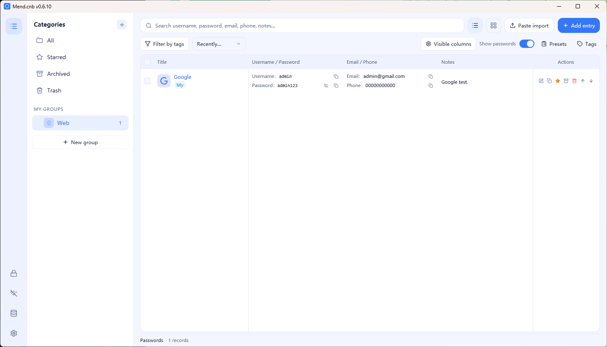
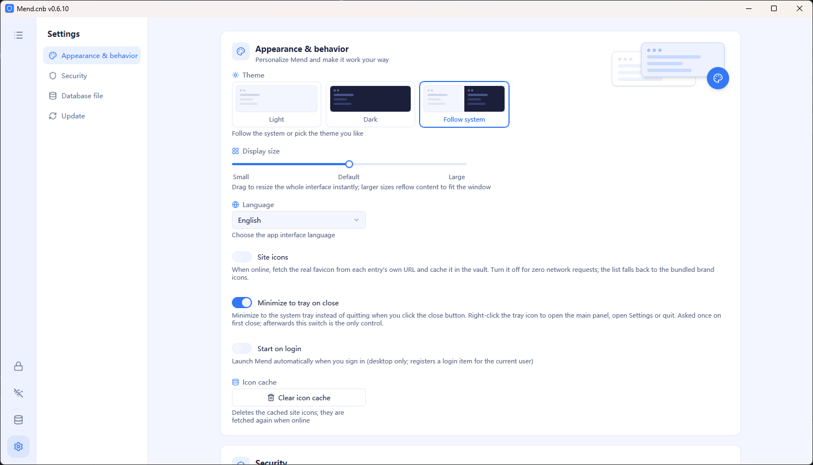

# Mend

> **Mend the gaps of your memory.**

[](./LICENSE)
[](#)
[](./CHANGELOG.md)

English | [简体中文](./README.zh-CN.md)

Mend is a local-first, offline, encrypted personal password manager. It is built on **Native Shell (nsh 0.5.0)**: a TSX native view layer over a Rust core (SQLite + Argon2id + XChaCha20-Poly1305), with no WebView, no HTML/CSS pages and no frontend bundler. All storage and cryptography happen in Rust; desktop and mobile share the same adaptive UI from a single codebase.

## ✨ Features

- **Encrypted local vault** — a SQLite database where account names, passwords, emails, phone numbers, notes and preset values are encrypted before they touch the disk.
- **Entry management** — title, username, password, URL, Markdown notes, tags and favorites.
- **Organization** — color and emoji categories, archive, trash and preset values.
- **Everyday tools** — strong password generator, search, sorting (recently updated / name / favorite / manual), copy-to-clipboard and open-in-browser.
- **Comfort** — auto-lock, light / dark / system themes, English and Chinese interfaces.
- **Backup** — encrypted `.mendbak` export and restore.
- **Updates** — in-app updates with signed OTA packages (releases are published on GitHub Releases).
- **Adaptive layout** — desktop master-detail (sidebar + list + detail) and single-column mobile from the same code.

## 🖼️ Screenshots

<table>
  <tr>
    <td align="center"><br>Main vault view</td>
    <td align="center"><br>Settings</td>
  </tr>
</table>

## 📥 Download

- [GitHub Releases](https://github.com/buzzyaaa/Mend/releases/latest) — primary source; in-app updates and OTA also use GitHub.
- [CNB mirror](https://cnb.cool/smybxg/Mend/-/releases) — China mirror with identical artifacts, recommended for users in mainland China.

## ☕ Support

If Mend helps you, you can support ongoing development via Ko-fi.

[](https://ko-fi.com/C0M32BD0S3)


> **A voluntary thank-you, not a purchase.** Mend stays free and open source for everyone, with or without a tip — all features and updates are open to you either way. Your kindness simply gives me more time to maintain and improve the app; it comes with no service, no feature promise, and no commercial relationship of any kind. Thank you for being here.

## 📦 Release files — what each artifact does

Every `v*` tag triggers `.github/workflows/release.yml`, which builds for Windows / Linux / macOS, signs the packages and publishes everything to the GitHub Release. A second job mirrors the artifacts to the CNB Release. Below is what each downloaded file is for (with `0.6.10` as an example version; `<build>` is the CI run number).

### Platform archives — used by the in-app updater

| File | Purpose |
| --- | --- |
| `Mend-0.6.10-windows-x86_64.zip` | Windows portable copy. This is the **app-update** archive: the updater downloads it, replaces the app and restarts. |
| `Mend-0.6.10-linux-x86_64.tar.gz` | Linux build. Same role as the Windows zip; ships as `tar.gz` to keep the executable bit. |
| `Mend-0.6.10-macos-aarch64.tar.gz` / `Mend-0.6.10-macos-x86_64.tar.gz` | macOS builds for Apple Silicon / Intel, respectively. |
| `Mend-cnb-0.6.10-<os>-<arch>.<ext>` | Identical build, but the update source (`updater.url`) is baked in as the CNB manifest. These users receive updates and OTA from CNB instead of GitHub. |

The `Mend.exe` inside the zip keeps a fixed filename (no version) on purpose — automatic updates and shortcuts rely on it. Only archive files (`.zip` / `.tar.gz`) participate in app updates; installers are not accepted by the updater.

### Windows installers — optional, manual download

| File | Purpose |
| --- | --- |
| `Mend-0.6.10-setup.exe` | Per-user Inno Setup installer. Adds a Start-menu entry and an "installed app" record; the first wizard page picks 简体中文 / English. Double-clicking an existing install upgrades it in place and keeps `%APPDATA%\com.mend.app`. |
| `Mend-cnb-0.6.10-setup.exe` | Same installer for the CNB variant, bundling the CNB update source. |

The installer is **a separate channel from automatic updates** — it is simply a convenience for people who want a conventional installed app. It is not Authenticode-signed, so SmartScreen may warn on first run (see [Code signing](#-code-signing)). The installer wizard language is remembered for upgrades and for the uninstaller; it is independent of the in-app language setting.

### OTA package — code-only update

| File | Purpose |
| --- | --- |
| `com.mend.app-18.nshpkg` | A **signed OTA code package** (TSX + assets), shared by both the GitHub and CNB variants. The app applies it on next launch. It replaces **only the code bundle, not the shell or the Rust native layer**, so a build that changes `native/` must be shipped as a full platform archive. |

### Update manifests — consumed by the app, not by humans

| File | Purpose |
| --- | --- |
| `latest.json` + `latest.json.sig` | Signed GitHub update manifest. Lists platform archives and the OTA package, with release notes and checksums. The app verifies the `.sig` against the public key in `nsh.json` before trusting anything. Published on GitHub only. |
| `latest-cnb.json` + `latest-cnb.json.sig` | Byte-identical CNB manifest kept on GitHub as an archive and for compatibility with the already-released 0.6.9 CNB build, which hard-codes that filename. On the CNB Release the **same content is published as `latest.json`** (nsh fixes the signature path to `<manifest dir>/latest.json.sig`, regardless of the manifest name). |
| `cnb/latest.json` + `cnb/latest.json.sig` | Staging copy uploaded to the CNB Release as `latest.json`. All URLs in it point at CNB direct-download links, so CNB users never contact GitHub for updates. |

> **Which file should I download?** Windows users who want a normal installed app take `Mend-<version>-setup.exe`; a plain `Mend.exe` you can unzip anywhere is inside the Windows zip. Linux / macOS users take the matching `.tar.gz`. Everything else (`.nshpkg`, `latest.json`, `.sig`) is fetched automatically by the app — you never need to download it by hand. Pick a `Mend-cnb-*` artifact if you prefer CNB as the update source; all other artifacts use GitHub.

### Signing keys (in the source tree, not shipped)

`keys/` holds the public material only: `root.pub`, `release.pub`, `release.cert` (the release signing certificate) and `update.pub`. The private keys (`*.secret`) are never committed — CI injects them as secrets and the root private key is stored offline. See [`docs/10-release-update.md`](./docs/10-release-update.md) §2.

## ⚠️ Disclaimer — open-source software

Mend is free, open-source software licensed under the [MIT License](./LICENSE). It is distributed **"AS IS"**, without warranty of any kind, express or implied, including but not limited to the warranties of merchantability, fitness for a particular purpose and non-infringement.

- **No absolute-security guarantee.** Mend encrypts your vault on disk and never uploads your secrets, but no software can guarantee that data can never be lost or compromised. Keep your device secure and make your own backups.
- **Your master password cannot be recovered.** There is no reset, no recovery key and no backdoor. If you lose both the master password and your backups, your data is gone permanently.
- **Back up regularly.** Copy `mend.db` (or an encrypted `.mendbak`) somewhere you trust, and test that you can restore it.
- **No liability.** To the fullest extent permitted by law, the authors and contributors are not liable for any claim, damage or data loss arising from the use of, or inability to use, this software.
- **Network use is limited and opt-out.** Only update checks and site-icon fetching touch the network; both can be turned off in Settings. Everything else stays local.

The same notice is available in the app under **Settings → About**.

## 🔏 Code signing

Windows releases are signed with a project key. We plan to move to a publicly trusted code signing certificate as the project grows; until then, Windows SmartScreen may show a publisher warning on first download.

## 🧰 Getting started

Install the Native Shell CLI and a Rust toolchain before developing.

**1. Install nsh CLI (0.5.0)**

```powershell
# Windows
irm https://nsh.dev/install.ps1 | iex
```

```bash
# macOS / Linux
curl -fsSL https://nsh.dev/install.sh | sh
```

Verify with `nsh --version`.

**2. Install Rust**

Use [rustup](https://rustup.rs). On Windows, both MinGW-w64 and MSVC work (match your Rust target). `rusqlite` builds SQLite from bundled sources, so a working C compiler is required.

**3. Open the repository root and start developing.**

## 🚀 Development

From the repository root:

```powershell
npm run dev        # clean start: stop old host/dev sessions, then nsh dev .
npm run dev:raw    # plain `nsh dev .` (no cleanup)
```

`nsh dev` runs the official native host with TSX hot reload; it compiles the Rust module on first run, and later changes take effect immediately.

**Why `npm run dev` by default:** `nsh dev` takes over the previous dev session by port (recorded in `%LOCALAPPDATA%\nsh\dev-sessions`). If an old host window is still open — or an old packaged `Mend.exe` is running on the desktop (it reads a bundle baked in at build time) — new code looks like it "didn't take effect". `scripts/dev.mjs` first stops `target\debug\nsh-app-*-windows-host.exe`, `.nsh\out\Mend\Mend.exe` and leftover dev servers, then clears the session records and starts a fresh host. Use `--dry-run` to see what would be cleaned up.

The repository's `.cargo/config.toml` pins Cargo build-script temp files to `.cargo/tmp` inside the repo, so Windows cc-rs temp-directory errors no longer block `nsh dev` — no extra setup is needed. That directory ships via `.cargo/tmp/.gitkeep`; if it is accidentally deleted, run `New-Item -ItemType Directory -Force .cargo/tmp` or the script below.

Optional, for faster builds and a consistent session PATH (installs nothing, changes no system settings):

```powershell
. .\scripts\dev-env.ps1   # point CARGO_HOME at the in-repo cache, prefer official nsh on PATH
```

`nsh run .` is no longer the main development entry; use it only for `--target web` / `--target tui` previews.

## ✅ Checks and tests

```powershell
nsh check .        # official type check
npm run typecheck  # equivalent TypeScript check (fallback)

nsh test .         # native cargo test + TSX headless tests
cargo test --manifest-path core\Cargo.toml   # crypto / SQLite / backup core tests
```

## 📦 Build and package

```powershell
nsh build .                    # output: .nsh/out
nsh package . --target windows # artifacts: Mend/Mend.exe, Mend.zip, Mend-<version>-windows-x86_64.zip, Mend.iss
```

With Inno Setup 6 installed, `nsh package` also produces an installer (otherwise it only writes `Mend.iss`, which is normal). The release workflow patches the script and rebuilds it as `Mend-<version>-setup.exe` (see [Release files](#-release-files--what-each-artifact-does)). Packaging needs no signing key — only `nsh publish` (the OTA package) does. To publish an official release, push a `v*` tag and `.github/workflows/release.yml` builds and publishes the GitHub Release automatically.

Equivalent npm scripts are available in `package.json`: `dev` / `build` / `package` / `test` / `check` / `typecheck`.

**VS Code**: the repo includes `.vscode/tasks.json` covering development, checks, tests, packaging and formatting — pick one from `Terminal → Run Task`.

## 📁 Project structure

- `App.tsx`: app entry (boot → setup / unlock → main).
- `screens/`: UnlockScreen, MainScreen and other screens.
- `components/`: native UI components (list, detail, editor, settings, etc.).
- `lib/`: native wrappers, state, errors, formatting, preferences.
- `native/`: nsh native module (`mend/native`), wrapping core and file operations.
- `core/`: `mend-core`, GUI-free Rust core (SQLite + Argon2id + XChaCha20-Poly1305).
- `locales/`: English and Chinese strings (`en.json`, `zh-CN.json`).

Also `nsh.json` (app metadata and `rust: native` declaration), `theme.json` (design tokens), `keys/` (public signing material) and `assets/`.

## 💾 Data and backup

- Data directory: `%APPDATA%\com.mend.app` on Windows (`~/Library/Application Support/com.mend.app` on macOS, `$XDG_DATA_HOME/com.mend.app` on Linux); viewable in the app's Settings.
- The vault is a single file, `mend.db`; sensitive fields are encrypted in Rust before being written to SQLite.
- Backups are encrypted `mend-backup-*.mendbak` files: export writes into the data directory, restore reads through the system file picker.
- Fully compatible with the old Tauri version: app id, vault name, schema, crypto parameters and backup format are unchanged, so old vaults and backups open directly with no migration.

## 📚 Documentation

- [`AGENTS.md`](./AGENTS.md): rules and hard constraints for agents / developers.
- [`docs/11-native-shell.md`](./docs/11-native-shell.md): source of truth for the current architecture after the 0.4.0 rewrite.
- [`docs/10-release-update.md`](./docs/10-release-update.md): release, signing, update manifests and the CNB mirror.
- `docs/01`–`09`: historical design records; their Tauri / Vue / WebView sections are obsolete — treat `docs/10`–`11` and `AGENTS.md` as authoritative.

## 📄 License

[MIT](./LICENSE)
