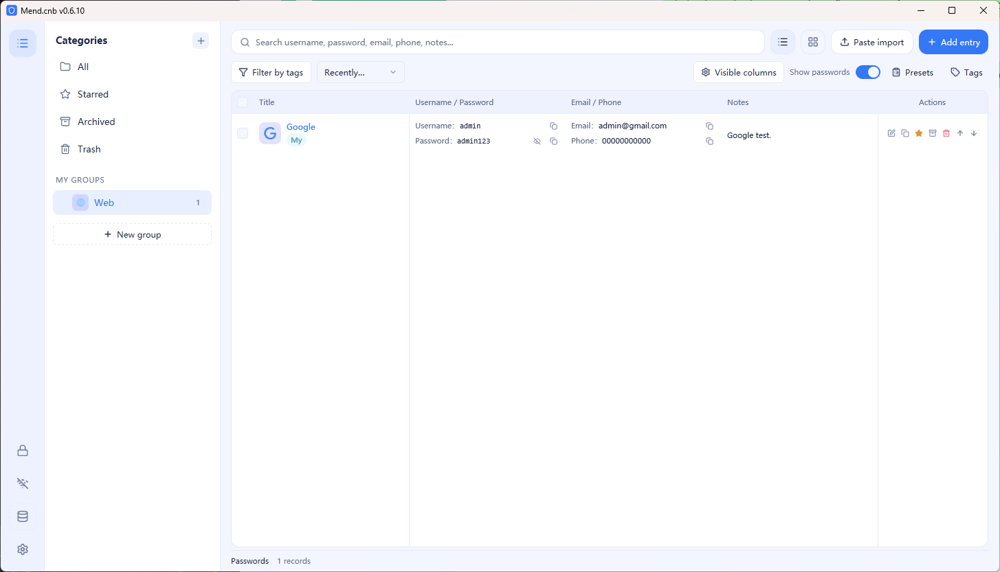
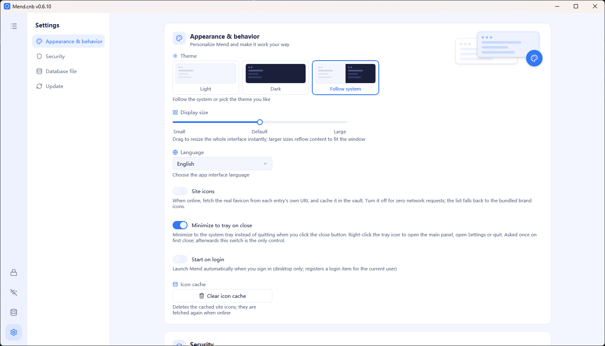

# Mend

> **Mend the gaps of your memory.**

[English](./README.md) | 简体中文

Mend 是一款本地离线、存盘加密的个人密码管理器，基于 **Native Shell（nsh 0.5.0）**：TSX 原生视图 + Rust 核心（SQLite / Argon2id / XChaCha20-Poly1305），不使用 WebView、HTML 或 CSS 页面，也没有前端打包器。数据与加密全部在 Rust 侧完成，桌面与手机共用同一份自适应 UI。

## ✨ 功能特性

- **加密本地密码库**：SQLite 数据库中，账号、密码、邮箱、手机号、备注、预设值等敏感字段在写入磁盘前完成加密。
- **条目管理**：标题、用户名、密码、网址、Markdown 备注、标签、收藏。
- **整理归类**：颜色 + emoji 分类、归档、回收站、预设值。
- **日常工具**：强密码生成器、搜索、排序（最近更新 / 名称 / 收藏 / 手动）、复制到剪贴板、打开网址。
- **使用体验**：自动锁定、浅色 / 深色 / 跟随系统主题、中英文界面。
- **备份**：加密的 `.mendbak` 导出与恢复。
- **更新**：应用内更新与签名 OTA 包（正式发布走 GitHub Releases）。
- **自适应布局**：同一份代码同时支持桌面 master-detail（侧栏 + 列表 + 详情）与手机单栏。

## 🖼️ 界面预览

<table>
  <tr>
    <td align="center"><br>密码库主界面</td>
    <td align="center"><br>设置页</td>
  </tr>
</table>

## 📥 下载

- [GitHub Releases](https://github.com/buzzyaaa/Mend/releases/latest)：主发布源；应用内更新与 OTA 也走 GitHub。
- [CNB 镜像](https://cnb.cool/smybxg/Mend/-/releases)：国内下载镜像，产物与 GitHub Release 完全一致，推荐中国大陆用户使用。

## ☕ 支持

如果 Mend 帮到了你，可以通过 Ko-fi 支持后续开发。

[](https://ko-fi.com/C0M32BD0S3)


> **这是一份自愿的心意，不是购买。** 无论是否打赏，Mend 的全部功能与更新都一视同仁地开放给你，项目始终保持免费和开源。你的支持只是让我有更多时间维护和改进它，不包含任何服务或功能承诺，也不形成任何商业关系。谢谢你愿意支持。

## 📦 发布文件说明（每个产物是做什么的）

每次推送 `v*` tag 都会触发 `.github/workflows/release.yml`：为 Windows / Linux / macOS 构建、签名，并把产物发布到 GitHub Release；另一个 job 再把产物镜像到 CNB Release。下面逐个说明下载到的文件的作用（以 `0.6.10` 为例，`<构建号>` 是 CI 运行序号）。

### 平台归档包（应用内自动更新用）

| 文件 | 作用 |
| --- | --- |
| `Mend-0.6.10-windows-x86_64.zip` | Windows 便携版。也是**整包更新**用的归档：更新器下载它、替换应用后重启。 |
| `Mend-0.6.10-linux-x86_64.tar.gz` | Linux 构建包，作用同上；用 `tar.gz` 是为了保留可执行位。 |
| `Mend-0.6.10-macos-aarch64.tar.gz` / `Mend-0.6.10-macos-x86_64.tar.gz` | 分别是 Apple Silicon / Intel 的 macOS 构建包。 |
| `Mend-cnb-0.6.10-<系统>-<架构>.<后缀>` | 与上面同一份构建，但把更新源（`updater.url`）固化成 CNB 清单。装了这个版本的用户从 CNB 而非 GitHub 取更新与 OTA。 |

zip 里的 `Mend.exe` 故意保持固定文件名（不带版本号）——自动更新和快捷方式都依赖它。只有归档文件（`.zip` / `.tar.gz`）参与应用更新，安装器不进清单。

### Windows 安装器（可选，手动下载）

| 文件 | 作用 |
| --- | --- |
| `Mend-0.6.10-setup.exe` | 当前用户级 Inno Setup 安装器，会创建开始菜单条目与「已安装应用」记录；第一步选简体中文 / English。双击即可原地升级已装版本，并保留 `%APPDATA%\com.mend.app` 里的数据。 |
| `Mend-cnb-0.6.10-setup.exe` | CNB 版的安装器，内置 CNB 更新源，其余完全相同。 |

安装器与自动更新是**两条独立通道**：它只是方便想装成常规应用的用户，更新器不接受它。安装器未做 Authenticode 签名，首次运行 SmartScreen 可能提示「未知发布者」（见[代码签名](#-代码签名)）。安装向导的语言会被升级安装与卸载向导沿用，与应用内语言偏好无关。

### OTA 代码包（只换代码）

| 文件 | 作用 |
| --- | --- |
| `com.mend.app-<构建号>.nshpkg` | **签名 OTA 代码包**（TSX + 资源），GitHub 版与 CNB 版共用同一份，应用下次启动时应用。它只替换代码包，**不换外壳、也不换 Rust 原生层**；因此只要改动了 `native/`，就必须发完整平台归档包。 |

### 更新清单（给程序读的，不用手动下载）

| 文件 | 作用 |
| --- | --- |
| `latest.json` + `latest.json.sig` | GitHub 原版签名清单，列出平台归档与 OTA 包、更新说明与校验值。应用先用 `nsh.json` 里的公钥验证 `.sig`，通过后才信任内容。只在 GitHub Release 发布。 |
| `latest-cnb.json` + `latest-cnb.json.sig` | 与 CNB 清单字节一致，留在 GitHub 作存档，并兼容已发布的 0.6.9 CNB 版（它把文件名写死为这个）。在 CNB Release 上，**同样内容以 `latest.json` 发布**——nsh 把签名路径写死为「清单所在目录/`latest.json.sig`」，与清单名无关。 |
| `cnb/latest.json` + `cnb/latest.json.sig` | 上传到 CNB Release 时改名为 `latest.json` 的暂存副本，里面所有下载地址都是 CNB 直链，CNB 用户更新全程不接触 GitHub。 |

> **我该下载哪个？** Windows 想要常规安装的应用就下 `Mend-<版本>-setup.exe`；想要解压即用的 `Mend.exe` 就在 Windows zip 里。Linux / macOS 下对应的 `.tar.gz`。其余 `.nshpkg`、`latest.json`、`.sig` 都由应用自动获取，无需手动下载。想用 CNB 作为更新源就选 `Mend-cnb-*` 开头的产物，其余产物走 GitHub。

### 签名密钥（在源码里，不随包发布）

`keys/` 只放公开材料：`root.pub`、`release.pub`、`release.cert`（发布签名证书）、`update.pub`。私钥（`*.secret`）永不入库，CI 以 secrets 注入，根私钥离线保管。详见 [`docs/10-release-update.md`](./docs/10-release-update.md) §2。

## ⚠️ 开源软件免责声明

Mend 是遵循 [MIT 许可证](./LICENSE) 的免费开源软件，按**「现状」**提供，不附带任何明示或暗示的担保，包括但不限于对适销性、特定用途适用性和不侵权的担保。

- **不承诺绝对安全**：Mend 在磁盘上加密密码库、从不上传你的数据，但没有任何软件能保证数据永不丢失或泄露。设备安全与备份由用户自行负责。
- **主密码无法找回**：没有重置、没有恢复密钥、也没有后门。主密码和备份同时丢失，数据将永久无法恢复。
- **请定期备份**：把 `mend.db`（或加密的 `.mendbak`）拷到可信的地方，并实际验证能恢复。
- **免责范围**：在法律允许的最大范围内，作者与贡献者不对因使用或无法使用本软件而产生的任何索赔、损害或数据丢失承担责任。
- **联网范围有限且可关闭**：只有更新检查与站点图标抓取会联网，两者都能在设置里关掉，其余全部本地完成。

同样的声明在软件的「设置 → 关于」中也可以看到。

## 🔏 代码签名

Windows 发布包使用项目密钥签名。项目成熟后计划改用公共信任的代码签名证书；在此之前，Windows SmartScreen 可能在首次下载时显示发布者警告。

## 🧰 环境准备

开发前先安装 Native Shell CLI，再准备 Rust 工具链。

**1. 安装 nsh CLI（0.5.0）**

```powershell
# Windows
irm https://nsh.dev/install.ps1 | iex
```

```bash
# macOS / Linux
curl -fsSL https://nsh.dev/install.sh | sh
```

安装完成后用 `nsh --version` 确认可用。

**2. 安装 Rust 工具链**

通过 [rustup](https://rustup.rs) 安装 Rust。Windows 上 MinGW-w64 或 MSVC 均可（与所选 Rust target 匹配即可）；`rusqlite` 以 bundled 方式编译 SQLite，需要一个可用的 C 编译器。

**3. 进入仓库根目录，即可开始开发。**

## 🚀 快速开发

在仓库根目录执行：

```powershell
npm run dev        # 干净启动：先结束旧的开发宿主/打包版进程、清空旧的 dev 会话，再 nsh dev .
npm run dev:raw    # 等价于直接 `nsh dev .`（不做清理）
```

`nsh dev` 使用官方原生宿主并带 TSX 热重载；首次运行会自动编译 Rust 模块，之后改动即改即生效。

**为什么默认用 `npm run dev`**：`nsh dev` 会按端口接管上一次的开发会话（记录在 `%LOCALAPPDATA%\nsh\dev-sessions`）。如果上次的宿主窗口还开着，或者桌面上还开着 **旧打包版 `Mend.exe`**（它读的是打包时写死的 bundle，永远停在那个构建），新代码看起来就"没生效"。`scripts/dev.mjs` 会先结束 `target\debug\nsh-app-*-windows-host.exe`、`.nsh\out\Mend\Mend.exe` 与残留的 nsh 开发服务器，清掉会话记录，再启动开发宿主，所以每次都是最新代码。只想看会清理什么可加 `--dry-run`。

仓库根的 `.cargo/config.toml` 已把 Cargo 构建脚本的临时目录固定到仓库内 `.cargo/tmp`，因此 Windows 上 cc-rs 的临时目录报错（`Cannot create temporary file ... Permission denied`）不会再挡住 `nsh dev`，**无需任何额外初始化**。该目录由 `.cargo/tmp/.gitkeep` 随仓库分发；若被误删（报 `No such file or directory`），执行 `New-Item -ItemType Directory -Force .cargo/tmp` 或运行下面的 `dev-env.ps1` 即可恢复。

需要更快的构建或统一的会话 PATH 时，可选执行（不安装、不修改系统设置）：

```powershell
. .\scripts\dev-env.ps1   # 把 CARGO_HOME 指到仓库内缓存，并让官方 nsh 的 PATH 优先
```

`nsh run .` 不再是主开发入口，仅在需要 `--target web` / `--target tui` 预览时使用。

## ✅ 检查与测试

```powershell
nsh check .        # 官方类型检查
npm run typecheck  # 等价的 TypeScript 检查（备用）

nsh test .         # native cargo test + TSX headless 测试
cargo test --manifest-path core\Cargo.toml   # 加密 / SQLite / 备份等核心测试
```

## 📦 构建与打包

```powershell
nsh build .                    # 输出到 .nsh/out
nsh package . --target windows # 产物：Mend/Mend.exe、Mend.zip、Mend-<版本>-windows-x86_64.zip、Mend.iss
```

安装了 Inno Setup 6 时，`nsh package` 还会额外产出安装包（未安装则只写 `Mend.iss`，属正常）。发布流水线会给 `Mend.iss` 打补丁并重新编译为 `Mend-<版本>-setup.exe`，各产物的用途见上面的[发布文件说明](#-发布文件说明每个产物是做什么的)。打包不需要签名密钥，只有 `nsh publish`（OTA 包）才需要。发布正式版：打 `v*` tag 后由 `.github/workflows/release.yml` 自动构建并发布 GitHub Release。

`package.json` 同时提供等价的 npm scripts：`dev` / `build` / `package` / `test` / `check` / `typecheck`。

**VS Code**：仓库内置 `.vscode/tasks.json`，任务覆盖开发、检查、测试、打包与格式化等常用流程，从 `Terminal → Run Task` 选择即可。

## 📁 项目结构

- `App.tsx`：应用入口（boot → setup / unlock → main）。
- `screens/`：UnlockScreen、MainScreen 等界面。
- `components/`：原生 UI 组件（列表、详情、编辑器、设置等）。
- `lib/`：native 封装、状态、错误、格式化、偏好。
- `native/`：nsh 原生模块（`mend/native`），封装 core 与文件操作。
- `core/`：`mend-core`，无 GUI 的 Rust 核心（SQLite + Argon2id + XChaCha20-Poly1305）。
- `locales/`：中英文文案（`en.json`、`zh-CN.json`）。

另有 `nsh.json`（应用元数据与 `rust: native` 声明）、`theme.json`（设计令牌）、`keys/`（公开签名材料）与 `assets/`。

## 💾 数据与备份

- 数据目录：Windows 为 `%APPDATA%\com.mend.app`（macOS 为 `~/Library/Application Support/com.mend.app`，Linux 为 `$XDG_DATA_HOME/com.mend.app`），可在应用内「设置」中查看。
- 密码库为单文件 `mend.db`；敏感字段在 Rust 侧加密后才写入 SQLite。
- 备份为 `mend-backup-*.mendbak` 加密文件：导出写入数据目录，恢复通过系统文件选择器读取。
- 与旧 Tauri 版本完全兼容：应用 id、库名、schema、加密参数与备份格式均未改变，旧库和旧备份可直接打开，无需迁移。

## 📚 文档索引

- [`AGENTS.md`](./AGENTS.md)：给后续 Agent / 开发者的规则与硬性约束。
- [`docs/11-native-shell.md`](./docs/11-native-shell.md)：0.4.0 重构后的当前架构事实来源。
- [`docs/10-release-update.md`](./docs/10-release-update.md)：发布、签名、更新清单与 CNB 镜像。
- `docs/01`–`09`：历史设计记录；其中 Tauri / Vue / WebView 段落已不适用，以 `docs/10`–`11` 与 `AGENTS.md` 为准。

## 📄 License

[MIT](./LICENSE)

---

## ☕ 支持

如果 Mend 帮到了你，可以通过 Ko-fi 支持后续开发。

[](https://ko-fi.com/C0M32BD0S3)


> **这是一份自愿的心意，不是购买。** 无论是否打赏，Mend 的全部功能与更新都一视同仁地开放给你，项目始终保持免费和开源。你的支持只是让我有更多时间维护和改进它，不包含任何服务或功能承诺，也不形成任何商业关系。谢谢你愿意支持。
